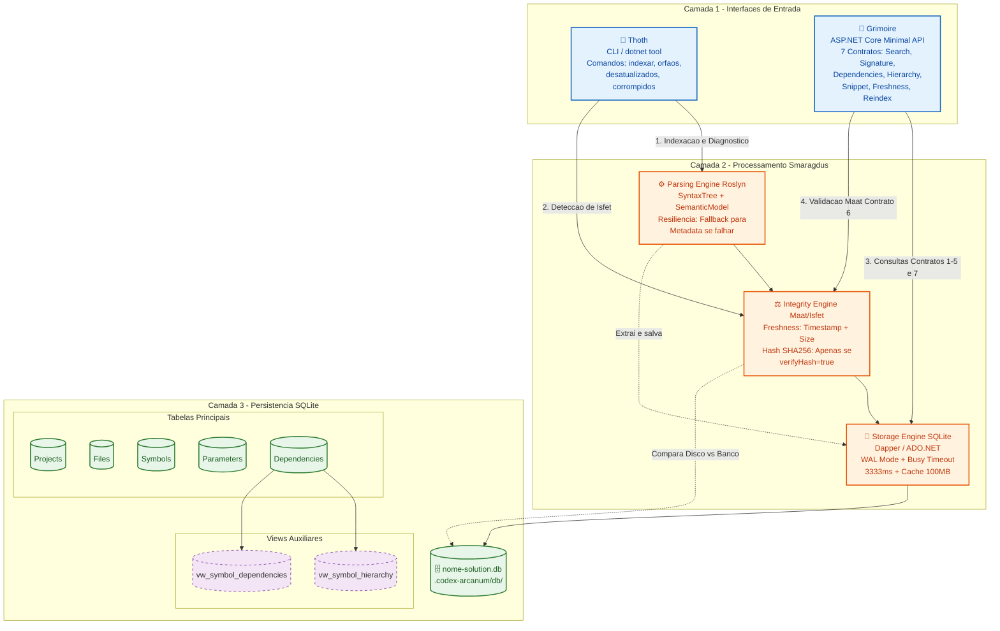

## 3. Implement (Implementação)

### 3.1. Estrutura de Soluções

#### 3.1.1. Layout dos Projetos

```text
CodexArcanum/
├── CodexArcanum.sln
├── src/
│   ├── CodexArcanum.Smaragdus/       # Class Library (.NET 10)
│   │   ├── Models/
│   │   ├── Parsing/
│   │   ├── Storage/
│   │   └── Services/
│   │
│   ├── CodexArcanum.Thoth/           # Console App (.NET 10) → dotnet tool
│   │   ├── Commands/
│   │   └── Program.cs
│   │
│   └── CodexArcanum.Grimoire/        # ASP.NET Core Web API + Servidor MCP (.NET 10)
│       ├── Endpoints/                # Contratos HTTP (7 endpoints)
│       ├── Mcp/                      # Tools MCP (espelham os 7 contratos, ver 2.7)
│       ├── Watcher/                  # FileSystemWatcher + debounce (ver 2.4.10)
│       ├── Middleware/
│       └── Program.cs
│
└── tests/
    ├── CodexArcanum.Smaragdus.Tests/ # xUnit
    └── CodexArcanum.Grimoire.Tests/  # xUnit + WebApplicationFactory
```

#### 3.1.2 📂 Detalhamento de Responsabilidades da Estrutura de Soluções

| Caminho / Item                    | Tipo                    | Responsabilidade e Regras de Negócio                                                                                                                                                                                                                                                                                                              |
| :-------------------------------- | :---------------------- | :------------------------------------------------------------------------------------------------------------------------------------------------------------------------------------------------------------------------------------------------------------------------------------------------------------------------------------------------ |
| **`CodexArcanum.sln`**            | Arquivo                 | Orquestra o build, as referências entre projetos e a execução de testes de toda a solução.                                                                                                                                                                                                                                                        |
| **`src/`**                        | Pasta                   | Contém todo o código-fonte de produção da aplicação.                                                                                                                                                                                                                                                                                              |
| **`CodexArcanum.Smaragdus/`**     | Class Library (.NET 10) | **O Coração do Sistema.** Contém toda a lógica de negócio, parsing e persistência. Não possui dependência de UI, CLI ou Web.                                                                                                                                                                                                                      |
| ↳ `Models/`                       | Pasta                   | Entidades de domínio puras (POCOs) que espelham exatamente o schema do SQLite (ex: `ProjectModel`, `FileModel`, `SymbolModel`, `DependencyModel`). **Regra:** Nenhuma lógica de negócio ou acesso a dados aqui.                                                                                                                                   |
| ↳ `Parsing/`                      | Pasta                   | Motor de extração via **Roslyn**. Contém a lógica para gerar `SyntaxTree` e `SemanticModel`. **Regra:** Deve implementar a resiliência (fallback para apenas `SyntaxTree` se o `SemanticModel` falhar) e nunca tocar no banco de dados diretamente.                                                                                               |
| ↳ `Storage/`                      | Pasta                   | Camada de persistência. Contém o `SqliteConnectionFactory` (configurado com **WAL Mode**, **Busy Timeout 3333ms** e **Cache 100MB**), a execução da DDL inicial e os repositórios de acesso aos dados.                                                                                                                                            |
| ↳ `Services/`                     | Pasta                   | Camada de orquestração. Contém:<br>• `IndexingService`: Coordena o fluxo `Disco` → `Parsing` → `Storage` (incluindo cálculo de Hash SHA256).<br>• `IntegrityService`: Implementa a lógica de **Maat** (comparação rápida de Timestamp/Tamanho + Hash sob demanda) e as queries de diagnóstico de **Isfet** (órfãos, desatualizados, corrompidos). |
| **`CodexArcanum.Thoth/`**         | Console App (.NET 10)   | **A Interface de Comando (dotnet tool).** Responsável apenas por orquestrar a CLI e chamar os serviços do Smaragdus.                                                                                                                                                                                                                              |
| ↳ `Commands/`                     | Pasta                   | Handlers dos comandos do `System.CommandLine`: `indexar`, `orfaos`, `desatualizados` e `corrompidos`.                                                                                                                                                                                                                                             |
| ↳ `Program.cs`                    | Arquivo                 | Ponto de entrada da CLI. Contém a lógica de **auto-detecção** (prioridade: `.sln` → `.csproj`), gerenciamento do `.gitignore` e formatação dos logs de saída.                                                                                                                                                                                     |
| **`CodexArcanum.Grimoire/`**      | Web API (.NET 10)       | **A Interface do Agente (Minimal API + MCP).** Responsável por expor os contratos via HTTP e via MCP, e validar as regras de borda.                                                                                                                                                                                                               |
| ↳ `Endpoints/`                    | Pasta                   | Implementação dos **7 Contratos Aprovados** (Busca, Assinatura, Dependências, Hierarquia, Snippet, Freshness, Reindex) mapeando as requisições HTTP para os serviços do Smaragdus.                                                                                                                                                                |
| ↳ `Mcp/`                          | Pasta                   | Tools MCP que espelham 1:1 os `Endpoints/` (ver 2.7 em `02-planejar.md`). **Regra:** nunca duplicar lógica de negócio — cada tool chama o mesmo Service usado pelo endpoint HTTP equivalente.                                                                                                                                                     |
| ↳ `Watcher/`                      | Pasta                   | `FileSystemWatcher` com debounce (500ms) que aciona a reindexação automática ao detectar alteração em arquivo indexado (ver 2.4.10). Eventos `Deleted` são ignorados (permanecem sob responsabilidade do `codex-thoth orfaos`).                                                                                                                   |
| ↳ `Middleware/`                   | Pasta                   | Validação de regras de negócio antes de chegar ao core. **Regras:** Bloquear snippets > 200 linhas (Maat), limitar reindex a 50 arquivos, rejeitar `path` absoluto/`..` (path traversal), e padronizar respostas de erro (ex: `SNIPPET_TOO_LARGE`, `FILE_NOT_FOUND`, `INVALID_PARAMETERS`).                                                       |
| ↳ `Program.cs`                    | Arquivo                 | Configuração da API (bind exclusivo em loopback, ver 2.5.5), do servidor MCP (stdio), injeção de dependência dos serviços do Smaragdus, inicialização do Watcher, e configuração de CORS/Logging.                                                                                                                                                 |
| **`tests/`**                      | Pasta                   | Contém os projetos de testes automatizados.                                                                                                                                                                                                                                                                                                       |
| ↳ `CodexArcanum.Smaragdus.Tests/` | xUnit Project           | Testes unitários do core. Testa o parsing do Roslyn com arquivos mockados, a geração de hashes e as queries SQLite (usando banco em memória ou temporário).                                                                                                                                                                                       |
| ↳ `CodexArcanum.Grimoire.Tests/`  | xUnit Project           | Testes de integração da API. Usa `WebApplicationFactory` para simular requisições HTTP e validar se os endpoints retornam os status codes (200, 400, 404) e o JSON exato dos contratos aprovados.                                                                                                                                                 |
| ↳ `Services/StatsService.cs`      | Arquivo                 | Orquestra as queries de estatísticas e formata a saída do comando `codex-thoth stats`                                                                                                                                                                                                                                                             |

#### 3.1.2. Grafo de Dependências entre Projetos

```
┌─────────────────────┐         ┌─────────────────────┐
│  CodexArcanum.Thoth │         │ CodexArcanum.Grimoire│
│   (Console App)     │         │   (Web API)         │
└──────────┬──────────┘         └──────────┬──────────┘
           │                               │
           │  referencia                   │  referencia
           ▼                               ▼
        ┌─────────────────────────────────────┐
        │   CodexArcanum.Smaragdus            │
        │      (Class Library)                │
        │         CORE - não depende de nada  │
        └─────────────────────────────────────┘
```

#### 3.1.3. Tabela de Referências entre Projetos

| Projeto             | Referencia                   | Justificativa                                                                           |
| ------------------- | ---------------------------- | --------------------------------------------------------------------------------------- |
| **Smaragdus**       | _(nenhum projeto interno)_   | É o core. Contém Models, Parsing (Roslyn), Storage (SQLite) e Services (Maat/Isfet).    |
| **Thoth**           | **Smaragdus**                | Usa os serviços de indexação, parsing e diagnóstico (Isfet) para os comandos CLI.       |
| **Grimoire**        | **Smaragdus**                | Usa os serviços de consulta, freshness (Maat) e reindexação para os 7 endpoints da API. |
| **Smaragdus.Tests** | **Smaragdus**                | Testes unitários do core (parsing, hashing, queries SQLite).                            |
| **Grimoire.Tests**  | **Grimoire** + **Smaragdus** | Testes de integração dos endpoints via `WebApplicationFactory`.                         |

#### 3.1.4. Pacotes NuGet por Projeto

| Projeto             | Pacotes NuGet                                           | Função                                                                                |
| ------------------- | ------------------------------------------------------- | ------------------------------------------------------------------------------------- |
| **Smaragdus**       | `Microsoft.CodeAnalysis.CSharp`                         | Roslyn para parsing de C# (SyntaxTree + SemanticModel)                                |
|                     | `Microsoft.CodeAnalysis.CSharp.Workspaces`              | Suporte a Workspaces do Roslyn (resolver .sln)                                        |
|                     | `Microsoft.Data.Sqlite`                                 | Acesso ao SQLite                                                                      |
|                     | `System.Text.Json`                                      | Serialização de `Modifiers` e `Attributes` (JSON em colunas TEXT)                     |
| **Thoth**           | `System.CommandLine`                                    | Framework CLI para os comandos `indexar`, `orfaos`, `desatualizados`, `corrompidos`   |
| **Grimoire**        | _(nenhum adicional — usa apenas o ASP.NET Core nativo)_ | Minimal API já vem no SDK                                                             |
|                     | `ModelContextProtocol`                                  | SDK oficial .NET para expor as tools MCP (transporte stdio) espelhando os 7 contratos |
| **Smaragdus.Tests** | `xunit`                                                 | Framework de testes                                                                   |
|                     | `xunit.runner.visualstudio`                             | Runner para Visual Studio / Rider                                                     |
|                     | `Microsoft.NET.Test.Sdk`                                | SDK de testes                                                                         |
| **Grimoire.Tests**  | `xunit`                                                 | Framework de testes                                                                   |
|                     | `Microsoft.AspNetCore.Mvc.Testing`                      | `WebApplicationFactory` para testes de integração                                     |
|                     | `Microsoft.NET.Test.Sdk`                                | SDK de testes                                                                         |

#### 3.1.5. Configuração Especial do Thoth (dotnet tool)

O `.csproj` do Thoth deve conter:

```xml
<PropertyGroup>
  <OutputType>Exe</OutputType>
  <TargetFramework>net10.0</TargetFramework>
  <PackAsTool>true</PackAsTool>
  <ToolCommandName>codex-thoth</ToolCommandName>
  <PackageId>CodexArcanum.Thoth</PackageId>
  <Version>1.0.0</Version>
  <PackageOutputPath>./nupkg</PackageOutputPath>
</PropertyGroup>
```

**Instalação local (desenvolvimento):**

```bash
dotnet pack src/CodexArcanum.Thoth -c Release
dotnet tool install --global --add-source src/CodexArcanum.Thoth/nupkg CodexArcanum.Thoth
```

**Atualização:**

```bash
dotnet tool update --global --add-source src/CodexArcanum.Thoth/nupkg CodexArcanum.Thoth
```

#### 3.1.6. Fluxo de Dados na Implementação

1. **Setup**: Desenvolvedor roda `codex-thoth indexar` → Thoth chama Smaragdus → Smaragdus parseia com Roslyn e grava no SQLite local.
2. **Consulta**: Agente chama `GET /api/symbols/search` (ou a tool MCP equivalente) → Grimoire recebe → Grimoire chama Smaragdus → Smaragdus executa query no SQLite, calcula `isStale` comparando `LastWriteUtc`/`FileSize` com o disco → retorna JSON.
3. **Edição + Watcher**: Agente edita um arquivo → o `FileSystemWatcher` do Grimoire detecta a alteração, aguarda o debounce (500ms) e reindexa automaticamente via Smaragdus, sem intervenção do agente.
4. **Manutenção (fallback manual)**: Se o watcher estiver indisponível, o agente chama `POST /api/reindex` → Grimoire valida limite de 50 arquivos e caminhos relativos → Grimoire chama Smaragdus → Smaragdus reprocessa só os arquivos alterados (DELETE + INSERT no banco) e devolve os novos `symbolId`.

### 3.2. Estratégia de Qualidade e TDD

- Utilize `Path.Combine`, `Path.GetTempPath`, `Path.GetFullPath` e `StringComparison.OrdinalIgnoreCase` para validações, evitando hardcoded de separadores (\ ou /) ou raízes de disco.

  Para garantir a resiliência do sistema, a implementação seguirá a metodologia TDD (Test-Driven Development):

#### 3.2.1. Testes Unitários (Smaragdus)

- Devem ser agnósticos ao SO. Nunca hardcode paths Unix (`/tmp`) ou Windows (`C:\`). Gere diretórios temporários dinamicamente via `Path.GetTempPath()` e use comparações de string case-insensitive para validação de paths.

- **SQLite In-Memory**: Todos os testes de storage e parsing utilizarão a connection string `Data Source=:memory:`. Isso garante isolamento total e execução ultra-rápida.
- **Dogfooding**: O conjunto de testes deve incluir a indexação da própria solução `CodexArcanum.sln`. O sistema deve ser capaz de indexar a si mesmo sem erros.
- **Fluxo**: Red $\rightarrow$ Green $\rightarrow$ Refactor.

#### 3.2.2. Testes de Integração (Grimoire)

- **WebApplicationFactory**: Utilização de testes de integração para validar os endpoints da API sem a necessidade de subir o servidor manualmente.
- **Validação de Contratos**: Cada endpoint deve ser testado para garantir que o JSON de retorno segue rigorosamente a especificação de contratos.

#### 3.2.3. Validação Manual via cURL

Cada endpoint deve ser validado manualmente via cURL para garantir a interoperabilidade bruta.
Exemplos de validação:

- `curl "http://localhost:3333/api/symbols/search?query=UserService"`
- `curl "http://localhost:3333/api/files/snippet?path=UserService.cs&start=10&end=50"`

---

### 3.3. 🎨 Diagrama Arquitetônico do Codex Arcanum



---

### 3.3 📜 DDL do Banco de Dados — Codex Arcanum

Segue o DDL completo, alinhado com todas as decisões que tomamos (sem multi-tenancy, com hash SHA256, pronto para os 7 contratos da API):

```sql
-- ============================================================================
-- Codex Arcanum - Schema do Banco de Dados
-- Localização: .codex-arcanum/db/{nome-solution}.db
-- ============================================================================

-- ----------------------------------------------------------------------------
-- Tabela: Projects
-- Representa os projetos (.csproj) contidos na solução
-- ----------------------------------------------------------------------------
CREATE TABLE IF NOT EXISTS Projects (
    Id          INTEGER PRIMARY KEY AUTOINCREMENT,
    Name        TEXT    NOT NULL,                              -- Nome do projeto (ex: "MinhaSolucao.Domain")
    Path        TEXT    NOT NULL UNIQUE,                       -- Caminho relativo do .csproj
    IndexedAt   TEXT    NOT NULL DEFAULT (strftime('%Y-%m-%dT%H:%M:%SZ', 'now'))
);

-- ----------------------------------------------------------------------------
-- Tabela: Files
-- Representa os arquivos .cs indexados
-- Usa o princípio de Maat: timestamp + tamanho + hash para validar integridade
-- ----------------------------------------------------------------------------
CREATE TABLE IF NOT EXISTS Files (
    Id            INTEGER PRIMARY KEY AUTOINCREMENT,
    ProjectId     INTEGER NOT NULL,
    Path          TEXT    NOT NULL,                            -- Caminho relativo à raiz da solução (portável entre máquinas/SO)
    LastWriteUtc  TEXT    NOT NULL,                            -- Timestamp UTC da última modificação
    FileSize      INTEGER NOT NULL,                            -- Tamanho em bytes
    Hash          TEXT    NOT NULL,                            -- SHA256 do conteúdo
    IndexedAt     TEXT    NOT NULL DEFAULT (strftime('%Y-%m-%dT%H:%M:%SZ', 'now')),
    ReindexCount  INTEGER NOT NULL DEFAULT 0,                  -- Incrementado a cada reindexação
    IndexStatus   TEXT    NOT NULL DEFAULT 'Success',          -- Success | Partial | Unparseable (ver 2.4.7)

    FOREIGN KEY (ProjectId) REFERENCES Projects(Id) ON DELETE CASCADE,
    UNIQUE(ProjectId, Path)
);

CREATE INDEX IF NOT EXISTS idx_files_indexstatus ON Files(IndexStatus);

CREATE INDEX IF NOT EXISTS idx_files_path ON Files(Path);

-- ----------------------------------------------------------------------------
-- Tabela: Symbols
-- Representa símbolos extraídos via Roslyn (classes, interfaces, métodos, etc.)
-- Suporta os contratos 1 (Busca), 2 (Assinatura) e 4 (Hierarquia)
-- ----------------------------------------------------------------------------
CREATE TABLE IF NOT EXISTS Symbols (
    Id          INTEGER PRIMARY KEY AUTOINCREMENT,
    FileId      INTEGER NOT NULL,
    Name        TEXT    NOT NULL,                              -- Nome curto (ex: "CreateUser")
    Kind        TEXT    NOT NULL,                              -- Class, Interface, Method, Property, etc.
    FullName    TEXT    NOT NULL,                              -- Nome completo com namespace (ex: "MyApp.Services.UserService.CreateUser")
    ReturnType  TEXT,                                          -- Tipo de retorno (nullable, só para métodos)
    LineStart   INTEGER NOT NULL,                              -- Linha inicial (1-based)
    LineEnd     INTEGER NOT NULL,                              -- Linha final (1-based, inclusivo)
    Modifiers   TEXT,                                          -- JSON array: ["public", "async", "static"]
    Attributes  TEXT,                                          -- JSON array: ["[HttpPost]", "[Authorize]"]
    XmlDoc      TEXT,                                          -- Documentação XML completa
    IsDynamicEntrypoint INTEGER NOT NULL DEFAULT 0,             -- 1 quando marcado via comentário `// codex-arcanum: entrypoint-dinamico` (ver 2.4.11)

    FOREIGN KEY (FileId) REFERENCES Files(Id) ON DELETE CASCADE
);

CREATE INDEX IF NOT EXISTS idx_symbols_name      ON Symbols(Name);
CREATE INDEX IF NOT EXISTS idx_symbols_fullname  ON Symbols(FullName);
CREATE INDEX IF NOT EXISTS idx_symbols_kind      ON Symbols(Kind);
CREATE INDEX IF NOT EXISTS idx_symbols_file      ON Symbols(FileId);

-- ----------------------------------------------------------------------------
-- Tabela: Parameters
-- Parâmetros de métodos (para o contrato 2 - Assinatura)
-- ----------------------------------------------------------------------------
CREATE TABLE IF NOT EXISTS Parameters (
    Id          INTEGER PRIMARY KEY AUTOINCREMENT,
    SymbolId    INTEGER NOT NULL,
    Name        TEXT    NOT NULL,                              -- Nome do parâmetro
    Type        TEXT    NOT NULL,                              -- Tipo completo (ex: "CreateUserRequest")
    IsOptional  INTEGER NOT NULL DEFAULT 0,                    -- 0 = obrigatório, 1 = opcional
    Position    INTEGER NOT NULL,                              -- Ordem do parâmetro (0-based)

    FOREIGN KEY (SymbolId) REFERENCES Symbols(Id) ON DELETE CASCADE
);

CREATE INDEX IF NOT EXISTS idx_parameters_symbol ON Parameters(SymbolId);

-- ----------------------------------------------------------------------------
-- Tabela: Dependencies
-- Grafo de dependências entre símbolos
-- Suporta os contratos 3 (Grafo) e 4 (Hierarquia)
--
-- Relationships possíveis:
--   - Inherits   : classe herda de outra (hierarquia)
--   - Implements : classe implementa interface (hierarquia)
--   - Calls      : método chama outro método (grafo)
--   - Uses       : método usa tipo como parâmetro/retorno (grafo)
-- ----------------------------------------------------------------------------
CREATE TABLE IF NOT EXISTS Dependencies (
    Id            INTEGER PRIMARY KEY AUTOINCREMENT,
    SourceId      INTEGER NOT NULL,                            -- Símbolo de origem (quem)
    TargetName    TEXT    NOT NULL,                            -- Nome do target (pode não estar indexado)
    TargetId      INTEGER,                                     -- FK para Symbols se o target estiver indexado (nullable)
    Relationship  TEXT    NOT NULL,                            -- Inherits, Implements, Calls, Uses
    FilePath      TEXT    NOT NULL,                            -- Arquivo onde a dependência ocorre
    Line          INTEGER NOT NULL,                            -- Linha da referência

    FOREIGN KEY (SourceId) REFERENCES Symbols(Id) ON DELETE CASCADE,
    FOREIGN KEY (TargetId) REFERENCES Symbols(Id) ON DELETE SET NULL
);

CREATE INDEX IF NOT EXISTS idx_dependencies_source     ON Dependencies(SourceId);
CREATE INDEX IF NOT EXISTS idx_dependencies_target     ON Dependencies(TargetName);
CREATE INDEX IF NOT EXISTS idx_dependencies_rel        ON Dependencies(Relationship);
CREATE INDEX IF NOT EXISTS idx_dependencies_target_id  ON Dependencies(TargetId);

-- ============================================================================
-- VIEWS auxiliares (opcional, mas facilitam queries dos contratos)
-- ============================================================================

-- View para o Contrato 4 (Hierarquia): facilita consultar baseClass e interfaces
CREATE VIEW IF NOT EXISTS vw_symbol_hierarchy AS
SELECT
    s.Id AS SymbolId,
    s.Name,
    s.FullName,
    d.Relationship,
    d.TargetName,
    d.TargetId
FROM Symbols s
INNER JOIN Dependencies d ON d.SourceId = s.Id
WHERE d.Relationship IN ('Inherits', 'Implements');

-- View para o Contrato 3 (Grafo): facilita consultas de Incoming/Outgoing
CREATE VIEW IF NOT EXISTS vw_symbol_dependencies AS
SELECT
    d.Id,
    d.SourceId,
    s.FullName AS SourceFullName,
    d.TargetName,
    d.TargetId,
    d.Relationship,
    d.FilePath,
    d.Line
FROM Dependencies d
INNER JOIN Symbols s ON s.Id = d.SourceId;

CREATE TABLE IF NOT EXISTS IndexRuns (
    Id INTEGER PRIMARY KEY AUTOINCREMENT,
    StartedAt TEXT NOT NULL,
    FinishedAt TEXT NOT NULL,
    DurationMs INTEGER NOT NULL,
    FilesProcessed INTEGER NOT NULL,
    FilesSkipped INTEGER NOT NULL,
    Status TEXT NOT NULL -- 'Success', 'Partial', 'Failed'
);

CREATE INDEX IF NOT EXISTS idx_indexruns_started ON IndexRuns(StartedAt);

```

---

## 📊 Resumo das tabelas

| Tabela           | Função                          | Contratos atendidos                       |
| ---------------- | ------------------------------- | ----------------------------------------- |
| **Projects**     | Projetos da solução             | —                                         |
| **Files**        | Arquivos .cs + metadados (Maat) | 5 (Snippet), 6 (Freshness)                |
| **Symbols**      | Símbolos extraídos via Roslyn   | 1 (Busca), 2 (Assinatura), 4 (Hierarquia) |
| **Parameters**   | Parâmetros de métodos           | 2 (Assinatura)                            |
| **Dependencies** | Grafo de relações               | 3 (Grafo), 4 (Hierarquia)                 |

## 🎯 Como cada contrato usa o schema

| Contrato                 | Tabelas envolvidas                                                    |
| ------------------------ | --------------------------------------------------------------------- |
| 1. Busca de Símbolos     | `Symbols` (WHERE Name LIKE ou FullName LIKE)                          |
| 2. Assinatura            | `Symbols` + `Parameters` (JOIN por SymbolId)                          |
| 3. Grafo de Dependências | `Dependencies` (WHERE SourceId = X ou TargetName = X)                 |
| 4. Hierarquia            | `Dependencies` (WHERE Relationship IN 'Inherits','Implements')        |
| 5. Snippet               | `Files` (para validar existência) + leitura do disco                  |
| 6. Freshness (Maat)      | `Files` (compara LastWriteUtc/FileSize/Hash com disco)                |
| 7. Reindex               | `Files` + `Symbols` + `Parameters` + `Dependencies` (DELETE + INSERT) |

#### ⚠️ Decisões importantes refletidas no DDL

1. **Sem multi-tenancy**: não há tabela `Solutions` nem coluna `SolutionId`. Cada solução tem seu próprio `.db`.
2. **Hash SHA256**: coluna `Hash` em `Files` para o "melhor de dois mundos" (timestamp + tamanho + hash).
3. **Modifiers e Attributes como JSON**: mais flexível que tabelas separadas, e raramente precisamos fazer query por eles.
4. **TargetId nullable em Dependencies**: permite registrar dependências para tipos que não estão indexados (ex: tipos do .NET BCL como `System.String`).
5. **ON DELETE CASCADE**: ao deletar um arquivo, todos os símbolos e dependências associados são removidos automaticamente (essencial para o reindex cirúrgico).

#### 🛠️ Apenas uma observação mínima:

Na tabela `Symbols`, as colunas `Modifiers` e `Attributes` estão como `TEXT` para armazenar JSON arrays. No SQLite, isso funciona perfeitamente. Apenas lembre-se de usar a biblioteca `System.Text.Json` no **Smaragdus** para serializar/desserializar esses campos.

Excelente. Isso é exatamente o que falta para fechar o ciclo entre o DDL (estrutura) e o Código C# (implementação).

Essas queries serão a base dos **Repositórios** no projeto `CodexArcanum.Smaragdus`.

Abaixo estão as queries otimizadas para os 7 contratos, usando **exatamente** o DDL que aprovamos.

---

### 🗄️ 3.4. Queries de Acesso a Dados (Repositórios Smaragdus)

#### Contrato 1: Busca de Símbolos (Search)

_Busca exata por `LIKE` (substring, case-insensitive via `COLLATE NOCASE`). Quando `fuzzy=true`, aplica normalização de acentos/caixa e tolerância a 1 caractere de diferença via `editdistance` (extensão SQLite carregada no Smaragdus) antes do `LIKE`; não é uma busca fonética nem trigram — apenas substring tolerante a erro de digitação leve._

```sql
SELECT
    s.Id AS symbolId,
    s.FullName,
    s.Kind,
    f.Path AS filePath,
    f.LastWriteUtc,
    f.FileSize,
    s.LineStart,
    s.LineEnd,
    s.XmlDoc AS xmlDocSummary
FROM Symbols s
INNER JOIN Files f ON s.FileId = f.Id
WHERE (s.Name LIKE @query OR s.FullName LIKE @query)
  AND (@type IS NULL OR s.Kind = @type)
ORDER BY s.FullName
LIMIT @limit OFFSET @offset; -- Regra de Maat: @limit máximo 100 por página (ver 2.5.2 e 2.6.1)
-- O campo "isStale" da resposta NÃO vem do SQL: o C# compara LastWriteUtc/FileSize com o FileInfo do disco
-- para cada linha (custo zero), preenchendo "isStale" sem query adicional (ver 2.6.1 "Nota isStale automático").
```

#### Contrato 2: Detalhes de Assinatura (Signature)

_Recupera o símbolo e seus parâmetros ordenados._

```sql
-- Query 1: Dados do Símbolo
SELECT Name, Kind, ReturnType, Modifiers, Attributes, XmlDoc, IsDynamicEntrypoint
FROM Symbols WHERE Id = @symbolId;

-- Query 2: Parâmetros (ordenados pela posição)
SELECT Name, Type, IsOptional, Position
FROM Parameters
WHERE SymbolId = @symbolId
ORDER BY Position ASC;

-- Query 3: Metadados do arquivo (para o C# calcular "isStale", ver 2.6.1)
SELECT f.LastWriteUtc, f.FileSize
FROM Files f
INNER JOIN Symbols s ON s.FileId = f.Id
WHERE s.Id = @symbolId;
```

#### Contrato 3: Grafo de Dependências (Dependencies)

_Usa a tabela `Dependencies` diretamente para flexibilidade Incoming/Outgoing._

```sql
-- Se direction = 'Incoming' (quem me chama)
SELECT
    d.SourceId AS symbolId,
    s.FullName AS callerName,
    d.FilePath,
    d.Line
FROM Dependencies d
INNER JOIN Symbols s ON d.SourceId = s.Id
WHERE d.TargetId = @symbolId
   OR d.TargetName = (SELECT FullName FROM Symbols WHERE Id = @symbolId);

-- Se direction = 'Outgoing' (quem eu chamo)
SELECT
    d.TargetId AS symbolId,
    d.TargetName AS calleeName,
    d.FilePath,
    d.Line
FROM Dependencies d
WHERE d.SourceId = @symbolId;
```

#### Contrato 4: Árvore de Hierarquia (Hierarchy)

_Consulta as relações de herança e implementação._

```sql
-- Base Class e Interfaces (quem eu herdo/implemento)
SELECT
    Relationship,
    TargetId AS symbolId,
    TargetName AS name
FROM Dependencies
WHERE SourceId = @symbolId
  AND Relationship IN ('Inherits', 'Implements');

-- Derived Classes (quem herda de mim)
SELECT
    d.SourceId AS symbolId,
    s.Name
FROM Dependencies d
INNER JOIN Symbols s ON d.SourceId = s.Id
WHERE (d.TargetId = @symbolId OR d.TargetName = (SELECT FullName FROM Symbols WHERE Id = @symbolId))
  AND d.Relationship = 'Inherits';
```

#### Contrato 5: Snippet de Arquivo (Validação)

_O SQL apenas valida se o arquivo existe e está indexado. A leitura das linhas é feita pelo C# (`File.ReadLines`)._

```sql
SELECT Id, Path
FROM Files
WHERE Path = @path;
-- Se retornar 0 linhas, a API retorna HTTP 404 (FILE_NOT_FOUND)
-- Se retornar, o C# lê o disco e valida se (end - start) <= 200 (Regra de Maat)
```

#### Contrato 6: Verificação de Frescor (Freshness / Maat)

_Retorna os metadados para comparação com o disco (sem calcular hash, a menos que `verifyHash=true`)._

```sql
SELECT
    Path,
    LastWriteUtc AS lastIndexed,
    FileSize AS indexedSize,
    Hash
FROM Files
WHERE Path = @path;
-- O C# compara `LastWriteUtc` e `FileSize` com o `FileInfo` do disco.
-- Se `verifyHash=true` e os tamanhos baterem, o C# calcula o SHA256 e compara com a coluna `Hash`.
```

#### Contrato 7: Reindexação Cirúrgica (Reindex)

_Aqui está a mágica do DDL aprovado: graças ao `ON DELETE CASCADE`, basta deletar o arquivo._

```sql
-- Passo 1: Deletar o arquivo (SQLite deleta automaticamente Symbols, Parameters e Dependencies associados)
DELETE FROM Files WHERE Path = @path;

-- Passo 2: O C# (Smaragdus) faz o parsing do arquivo atualizado e executa os INSERTs:
-- INSERT INTO Files (...) VALUES (...)
-- INSERT INTO Symbols (...) VALUES (...)
-- INSERT INTO Parameters (...) VALUES (...)
-- INSERT INTO Dependencies (...) VALUES (...)

-- Passo 3: Recupera os símbolos recém-inseridos para devolver na resposta (evita round-trip extra de /search)
SELECT Id AS symbolId, FullName, Kind
FROM Symbols
WHERE FileId = @newFileId
ORDER BY LineStart;
```

### 3.5. Queries de Estatísticas (StatsService)

#### 3.5.1. Visão Geral

```sql
SELECT
    (SELECT COUNT(*) FROM Projects) AS TotalProjects,
    (SELECT COUNT(*) FROM Files) AS TotalFiles,
    (SELECT COUNT(*) FROM Symbols) AS TotalSymbols,
    (SELECT SUM(FileSize) FROM Files) AS TotalSizeBytes;
```

#### 3.5.2. Hotspots de Acoplamento (Top 5 God Files)

```sql
SELECT
    f.Path,
    COUNT(d.SourceId) AS IncomingCalls
FROM Files f
INNER JOIN Symbols s ON s.FileId = f.Id
INNER JOIN Dependencies d ON s.Id = d.TargetId OR s.FullName = d.TargetName
WHERE d.Relationship = 'Calls'
GROUP BY f.Id
ORDER BY IncomingCalls DESC
LIMIT 5;
```

#### 3.5.3. Saúde do Contexto (XML Docs)

```sql
SELECT
    Kind,
    COUNT(CASE WHEN XmlDoc IS NOT NULL AND XmlDoc != '' THEN 1 END) AS ComDoc,
    COUNT(CASE WHEN XmlDoc IS NULL OR XmlDoc = '' THEN 1 END) AS SemDoc,
    COUNT(*) AS Total,
    ROUND(100.0 * COUNT(CASE WHEN XmlDoc IS NOT NULL AND XmlDoc != '' THEN 1 END) / COUNT(*), 2) AS Percentual
FROM Symbols
WHERE Kind IN ('Class', 'Interface', 'Method')
GROUP BY Kind;
```

#### 3.5.4. Raio-X do Caos (Isfet)

```sql
SELECT
    IndexStatus,
    COUNT(*) AS Quantidade
FROM Files
GROUP BY IndexStatus;
```

#### 3.5.5. Histórico de Execução (Última)

```sql
SELECT
    StartedAt,
    FinishedAt,
    DurationMs,
    FilesProcessed,
    FilesSkipped,
    Status
FROM IndexRuns
ORDER BY StartedAt DESC
LIMIT 1;
```

#### 3.5.6. Arquivos Mais Alterados (Hot Files)

```sql
SELECT
    Path,
    ReindexCount
FROM Files
WHERE ReindexCount > 0
ORDER BY ReindexCount DESC
LIMIT 5;
```
